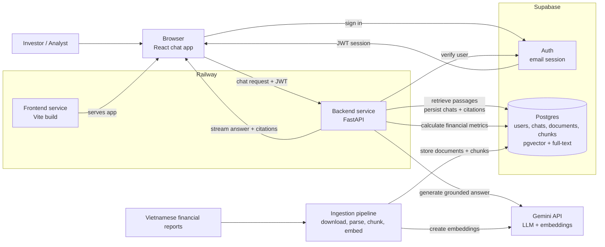

# Document AI Assistant Architecture

## Purpose

Document AI Assistant is an AI-powered research assistant for investors and equity analysts who need grounded answers and multi-year financial analysis from a curated corpus of Vietnamese financial reports.

The architecture must optimize for trust: every answer is grounded in retrieved source passages, every factual claim is citable, financial metrics are calculated from source data, and the system fails clearly when the corpus does not support an answer.

This document describes the target architecture for the chat experience, LLM orchestration, retrieval, financial analysis, and communication between the React SPA, Supabase, and FastAPI backend.

The initial demo corpus is limited to FPT, VCB, MWG, and VIC for 2021–2025. It includes annual reports (BCTN) and consolidated annual financial statements (BCTC).

## High-Level Architecture

The best opening diagram is a service-level view that shows the two core paths: the live chat path that serves users, and the ingestion path that prepares financial reports for retrieval and analysis.



## Architectural Goals

* Keep the browser thin: it renders chat state, manages the user's Supabase session, and communicates with FastAPI.
* Keep the backend authoritative: retrieval, financial calculations, grounding, citation checks, and database writes happen in FastAPI.
* Use Supabase for identity and durable product state: users, chat threads, source documents, chunks, embeddings, and citation metadata.
* Use Supabase `pgvector` for semantic retrieval and PostgreSQL full-text search for keyword retrieval.
* Keep financial calculations deterministic and separate from LLM generation.
* Make the LLM layer structured and testable with explicit inputs, outputs, and tool boundaries.
* Keep deployment simple: one frontend service, one stateless backend service, and hosted Supabase.

## Stack

Frontend:

* Vite + React SPA + TypeScript
* React Router for routing
* Tailwind CSS and shadcn/ui for UI
* `@supabase/supabase-js` for browser authentication

Backend:

* Python 3.12+
* FastAPI + Uvicorn
* Pydantic v2 + pydantic-settings
* Google Gen AI SDK for Gemini generation and embeddings
* Supabase Python client for server-side database access
* SQLAlchemy models + Alembic migrations
* Supabase `pgvector` for semantic search
* PostgreSQL full-text search for lexical retrieval
* `httpx` for outbound HTTP
* `structlog` for structured logs

Persistence:

* Supabase Auth for email login
* Supabase Postgres for user records, chat threads, chat messages, source documents, chunks, embeddings, financial data, and citation metadata

## System Boundaries

The frontend is responsible for user interaction, local UI state, authentication state, and sending authenticated requests to the backend.

It should never:

* Hold service-role credentials
* Run retrieval logic
* Call Gemini directly
* Perform privileged database writes
* Calculate financial metrics that are part of the trusted research workflow

The backend is responsible for:

* Request authorization
* Retrieval
* Financial calculations
* Prompt construction
* LLM execution
* Citation validation
* Streaming responses
* Durable persistence

It owns all privileged credentials and is the only service allowed to use the Supabase service-role key.

Supabase is responsible for authentication and durable product state.

Browser access uses the anon key and user JWT. Server access uses the user's bearer token for user-scoped operations and the service-role key only for privileged backend operations.

## Request Flow

1. The user signs in with Supabase email authentication in the React SPA.
2. The frontend stores the Supabase session through `@supabase/supabase-js`.
3. When the user opens a chat, the frontend loads the thread and prior messages through FastAPI.
4. The chat UI submits a new user message to the FastAPI chat endpoint.
5. The frontend sends the Supabase access token as `Authorization: Bearer <token>`.
6. FastAPI verifies the token before performing retrieval or LLM work.
7. FastAPI creates a request-scoped context containing the authenticated user, chat thread, database access, retrieval service, financial analysis service, and LLM settings.
8. The backend retrieves relevant document chunks and structured financial data.
9. Deterministic calculations are performed where required, such as YoY growth, CAGR, margins, or multi-year comparisons.
10. The LLM generates an answer grounded in the retrieved evidence and calculated results.
11. FastAPI validates that citations refer only to retrieved source passages.
12. FastAPI streams the answer and citation metadata back to the browser.
13. FastAPI persists the final user message, assistant message, citations, and relevant metadata to Supabase.

## Frontend Chat Layer

The frontend remains a plain Vite SPA.

The chat module should be organized around these responsibilities:

* `src/lib/env.ts` validates frontend environment variables.
* `src/lib/supabase.ts` creates the browser Supabase client.
* `src/lib/http.ts` wraps `fetch`, applies the backend base URL, injects the Supabase bearer token, and handles API errors.
* `src/lib/api.ts` exposes product-level API calls such as loading threads, creating threads, and fetching message history.
* `src/pages/chat/*` renders chat routes.
* `src/components/chat/*` renders messages, citations, financial metrics, source passages, empty states, and streaming status.

The frontend should treat the backend as the source of truth for assistant responses, calculations, citations, and retrieved evidence.

Conceptual shape:

```ts
const response = await fetch(`${apiBaseUrl}/chat/stream`, {
  method: "POST",
  headers: {
    Authorization: `Bearer ${accessToken}`,
    "Content-Type": "application/json",
  },
  body: JSON.stringify({
    threadId,
    message,
  }),
});
```

The exact streaming implementation can be chosen during development. The architectural rule is stable: the browser communicates with FastAPI, and FastAPI owns the assistant run.

## Backend LLM Layer

The backend should keep the LLM boundary separate from retrieval and financial calculations.

Recommended backend modules:

```text
backend/app/
├── api/
│   └── chat.py                 # FastAPI routes for chat and streaming
├── auth/
│   └── dependencies.py         # Supabase JWT verification
├── chat/
│   ├── orchestrator.py         # Coordinates one chat turn
│   ├── messages.py             # Internal message types
│   └── streaming.py            # Streaming responses
├── assistant/
│   ├── agent.py                # LLM orchestration
│   ├── outputs.py              # Structured answer types
│   └── instructions.md         # Assistant instructions
├── retrieval/
│   ├── queries.py              # pgvector and full-text queries
│   ├── fusion.py               # Reciprocal Rank Fusion
│   └── retriever.py            # Retrieval logic
├── analysis/
│   ├── calculator.py           # Financial calculations
│   ├── metrics.py              # Financial metric definitions
│   └── trends.py               # Multi-year trend analysis
├── grounding/
│   └── validator.py            # Citation and evidence validation
└── database/
    ├── supabase.py             # Supabase client construction
    ├── models.py               # SQLAlchemy models
    ├── chats.py                # Chat persistence
    └── documents.py            # Document and chunk queries
```

The responsibilities should remain separated:

* `chat/orchestrator.py` owns the lifecycle of a chat turn.
* `assistant/agent.py` owns the LLM boundary.
* `retrieval/` owns source-document retrieval.
* `analysis/` owns deterministic financial calculations.
* `grounding/` owns citation and evidence validation.
* `database/` owns persistence.

The LLM should not be responsible for inventing or manually calculating trusted financial figures.

Conceptual output:

```python
class Citation(BaseModel):
    document_id: str
    page: int | None
    chunk_id: str


class SourcePassage(BaseModel):
    chunk_id: str
    text: str
    page: int | None


class GroundedAnswer(BaseModel):
    answer: str
    citations: list[Citation]
    source_passages: list[SourcePassage]
```

## Retrieval Strategy

Document AI Assistant uses hybrid retrieval:

1. Embed the user's query with the configured Gemini embedding model.
2. Run semantic search over document chunks using `pgvector`.
3. Run lexical search using PostgreSQL full-text search.
4. Fuse the ranked results in Python using Reciprocal Rank Fusion.
5. Fetch the selected chunks and relevant document metadata.
6. Provide the retrieved evidence to the LLM for grounded generation.

For financial questions, retrieval may combine:

* Narrative document passages
* Financial statement data
* Company metadata
* Fiscal year metadata
* Section or page metadata

The first implementation should use bounded backend tools rather than allowing the LLM to generate arbitrary SQL.

Example tools:

```text
search_documents
read_chunk
read_surrounding_chunks
get_financial_data
calculate_metric
```

## Financial Analysis Layer

Financial analysis is separate from LLM generation.

The backend should perform deterministic calculations such as:

* Revenue growth
* Earnings growth
* CAGR
* Gross margin
* Operating margin
* Net margin
* Year-over-year changes
* Multi-year comparisons

For example:

```text
Source financial data
        ↓
Validated numeric values
        ↓
Deterministic calculation
        ↓
Structured result
        ↓
LLM explanation
```

The calculated result should retain references to the underlying source data so that the final answer remains traceable.

CANSLIM-related evaluation should also remain evidence-based. The system may identify supporting or conflicting evidence in the reports, but it must not turn that evidence into unsupported stock recommendations.

## Supabase and FastAPI Communication

Supabase Auth is the identity source. FastAPI treats the browser's Supabase JWT as the request credential.

Frontend rules:

* Use the anon key only in the browser.
* Read the current session through the shared Supabase client.
* Send the access token to FastAPI.
* Never expose the service-role key.

Backend rules:

* Verify `Authorization: Bearer <token>` at the FastAPI boundary.
* Reject unauthenticated requests before retrieval or LLM work.
* Derive `user_id` from the verified Supabase user.
* Enforce user ownership on chat threads and messages.
* Use the service-role key only for privileged backend operations.

Recommended backend units:

* `app/auth/dependencies.py` validates bearer tokens.
* `app/database/supabase.py` creates Supabase clients.
* `app/database/chats.py` stores chat threads, messages, and citations.
* `app/database/documents.py` stores and queries financial reports and document chunks.

## Streaming Contract

The frontend should receive incremental assistant output rather than waiting for the complete answer.

Recommended endpoint:

```text
POST /chat/stream
Authorization: Bearer <supabase_access_token>
Content-Type: application/json
```

Request body:

```json
{
  "threadId": "uuid",
  "message": "How did FPT's revenue grow from 2021 to 2025?"
}
```

Streaming responsibilities:

* Send answer text incrementally.
* Send citation metadata as structured data.
* Send calculation results where relevant.
* Send clear errors for authentication, retrieval, calculation, and grounding failures.
* Persist the completed assistant response after a successful run.

## Data Model

Supabase tables should remain small and product-oriented:

* `profiles`: authenticated user profile.
* `chat_threads`: conversation metadata and ownership.
* `chat_messages`: user and assistant messages.
* `message_citations`: citations linked to assistant messages.
* `source_documents`: financial report metadata and source information.
* `document_chunks`: chunk text, metadata, embeddings, and full-text search vectors.
* `financial_data`: structured financial figures extracted from source documents.

`source_documents` should contain metadata such as:

* Ticker
* Company
* Report type
* Reporting year
* Publication date
* Source URL
* Page count

`document_chunks` should contain:

* Chunk ID
* Document ID
* Chunk index
* Page or section metadata
* Chunk text
* Embedding vector
* Full-text search vector
* Metadata such as ticker, company, year, section, and source offsets

`financial_data` should contain validated structured values where appropriate:

* Company
* Ticker
* Fiscal year
* Metric
* Value
* Unit
* Source document
* Source page

## Schema Management

Database schema changes are managed with SQLAlchemy models and Alembic migrations.

The workflow is:

1. Update SQLAlchemy models.
2. Generate a candidate Alembic migration.
3. Review the migration.
4. Add explicit migration operations for Postgres/Supabase features where required.
5. Apply the migration locally or against the linked Supabase database.
6. Commit both the model changes and migration file.

Special database features such as `pgvector`, full-text search indexes, and RLS policies should be explicitly reviewed rather than relying entirely on autogeneration.

## Grounding and Citation Policy

Grounding is part of the architecture.

The backend should enforce these invariants:

* Every factual answer has supporting citations.
* Every citation maps to retrieved source evidence.
* Cited passages contain enough metadata to identify the company, report, year, and page where available.
* The model cannot cite documents that were not retrieved for the current request.
* Calculated metrics must be traceable to their underlying source values.
* Unsupported claims must result in a controlled refusal or an explicit statement that the corpus does not provide enough evidence.

This policy should be covered by backend tests around retrieval, calculations, citation extraction, and grounding enforcement.

## Error Handling

Expected error classes:

* `401 Unauthorized`: missing or invalid authentication.
* `403 Forbidden`: user attempts to access another user's thread.
* `404 Not Found`: thread or document does not exist.
* `422 Unprocessable Entity`: invalid request payload.
* `502 Bad Gateway`: upstream LLM or Supabase failure.
* `500 Internal Server Error`: unexpected backend failure.

The frontend should render user-friendly messages while backend logs preserve enough detail for debugging.

## Configuration

Frontend settings:

* `VITE_API_BASE_URL`
* `VITE_SUPABASE_URL`
* `VITE_SUPABASE_ANON_KEY`

Backend settings:

* `SUPABASE_URL`
* `SUPABASE_ANON_KEY`
* `SUPABASE_SERVICE_ROLE_KEY`
* `DATABASE_URL`
* `GEMINI_API_KEY`
* `GEMINI_MODEL`
* `GEMINI_EMBEDDING_MODEL`
* `GEMINI_EMBEDDING_DIMENSIONS` (must match the pgvector column dimension)
* `ALLOWED_ORIGINS`
* Embedding model configuration

Environment variables should be accessed through dedicated configuration modules rather than directly throughout the application.

## Deployment Shape

Railway should run two services:

* Frontend: Vite production build
* Backend: FastAPI + Uvicorn

Supabase remains hosted and stores:

* User data
* Conversations
* Financial reports metadata
* Document chunks
* Embeddings
* Financial data
* Citations

The backend remains stateless. Local downloaded reports used during ingestion are not part of the application deployment image unless a separate document-storage workflow is introduced later.

## Implementation Sequence

1. Scaffold the React frontend and FastAPI backend.
2. Add SQLAlchemy models and Alembic migrations.
3. Add Supabase Auth and authentication dependencies.
4. Add the shared frontend API client.
5. Add chat threads and message persistence.
6. Add the chat streaming endpoint with a stubbed response.
7. Add financial-report ingestion and parsing.
8. Add document chunking and embeddings.
9. Add semantic search with `pgvector`.
10. Add PostgreSQL full-text search and RRF fusion.
11. Add structured financial data and deterministic calculations.
12. Add LLM orchestration and grounded answer generation.
13. Add citation validation and source passages.
14. Add multi-year financial analysis and CANSLIM evidence extraction.
15. Add frontend citation, source passage, metric, and error UI.
16. Add tests and deploy to Railway.

## Non-Goals

* No direct stock trading.
* No automated trading.
* No unsupported stock picks or investment recommendations.
* No real-time market data.
* No news, social media, or alternative data in the initial system.
* No multi-tenant architecture.
* No mobile application.
